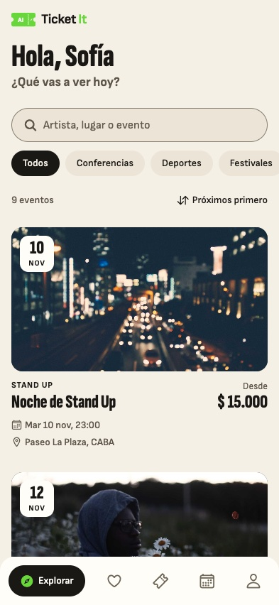
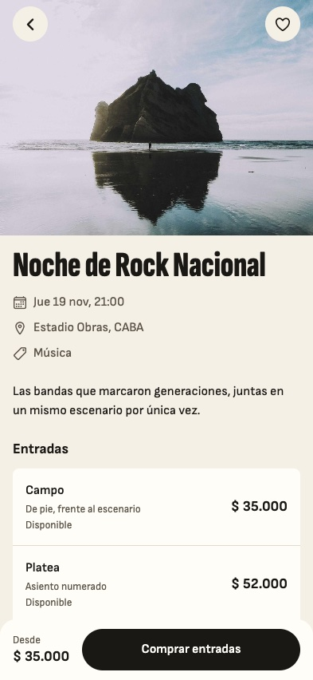
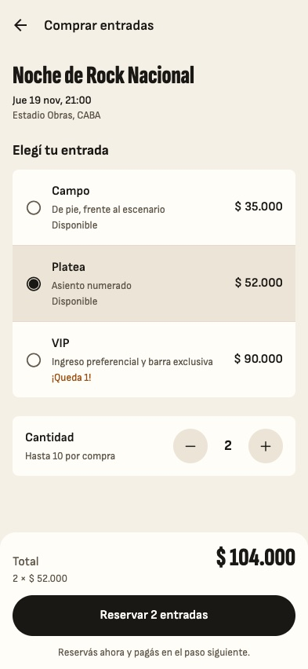
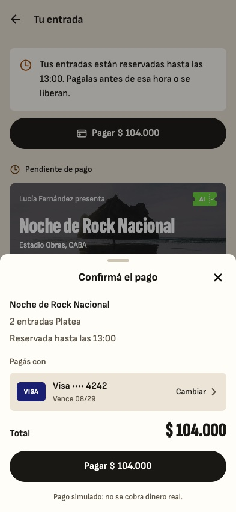
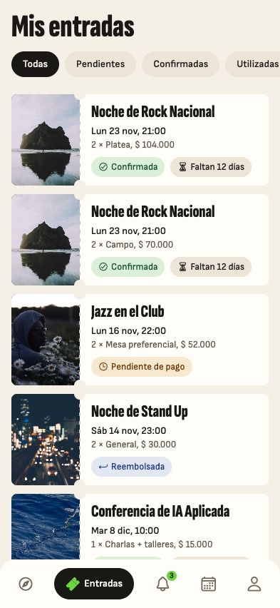
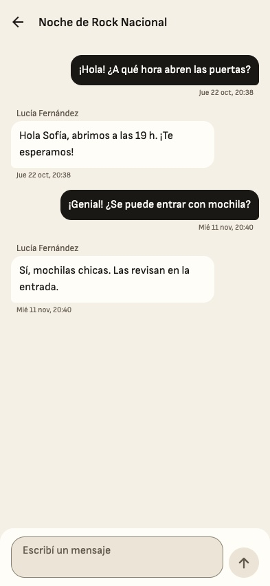
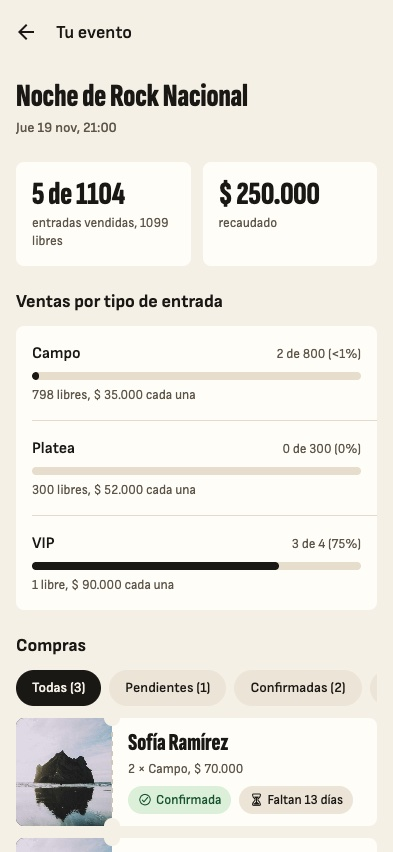
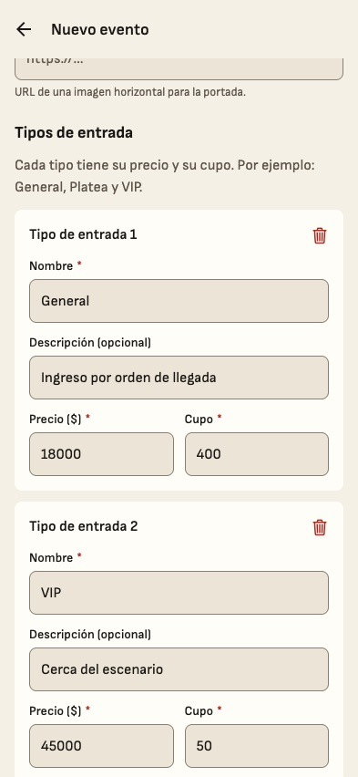
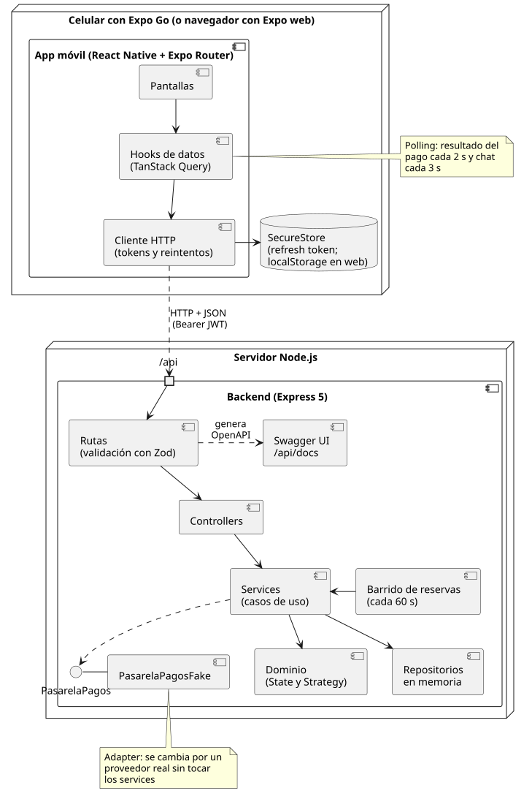
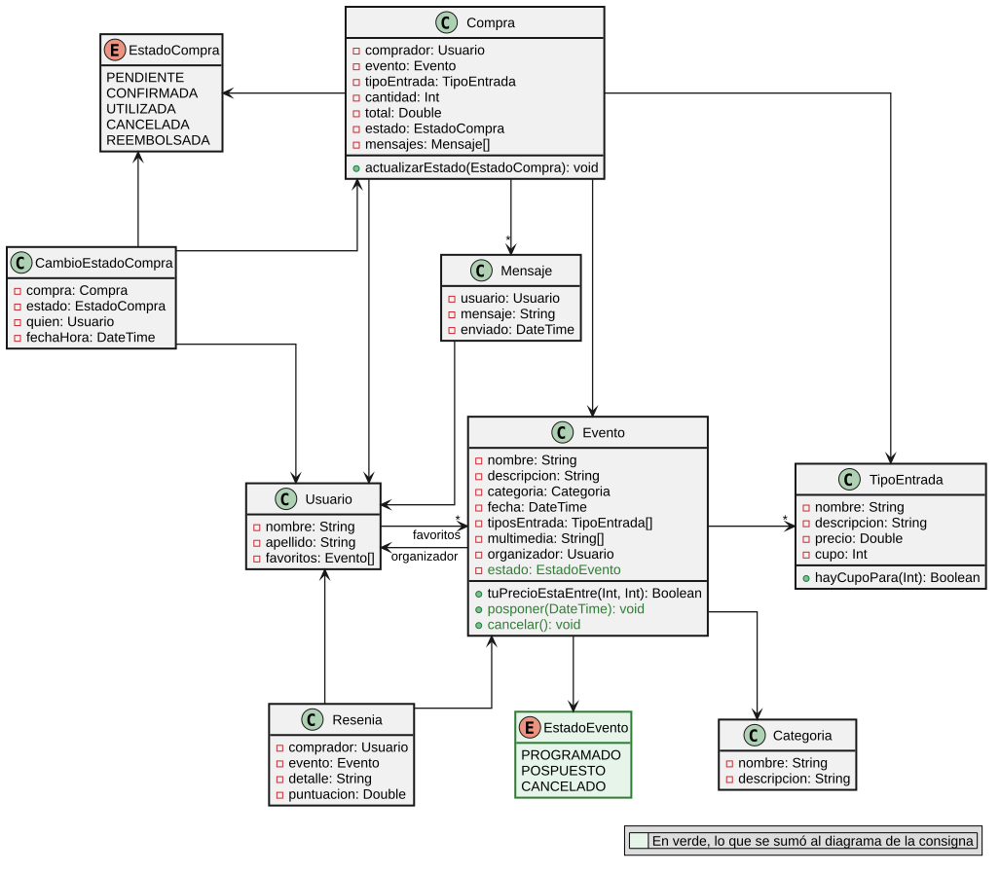

# AI Ticket It

Plataforma para publicar eventos y vender entradas. Los organizadores crean eventos con distintos tipos de entrada y siguen sus ventas; los compradores buscan, compran, chatean con el organizador y reseñan lo que vieron.

Trabajo Práctico Individual de Desarrollo con IA. Diseño de Sistemas de Información, UTN FRBA, 2C 2026.

<table>
  <tr>
    <td align="center"><br /><sub>Explorar</sub></td>
    <td align="center"><br /><sub>Evento</sub></td>
    <td align="center"><br /><sub>Comprar</sub></td>
    <td align="center"><br /><sub>Pagar</sub></td>
  </tr>
  <tr>
    <td align="center"><br /><sub>Mis entradas</sub></td>
    <td align="center"><br /><sub>Chat</sub></td>
    <td align="center"><br /><sub>Ventas (organizador)</sub></td>
    <td align="center"><br /><sub>Nuevo evento (organizador)</sub></td>
  </tr>
</table>

## Empezar en 5 minutos

Requisitos: Node 22.9 o superior y la app **Expo Go** en el celular, conectado al mismo Wi-Fi que la computadora.

```bash
cd backend && npm install && npm run dev
```

```bash
cd mobile && npm install && npx expo start
```

Escaneá el QR con la cámara (iOS) o con Expo Go (Android) e iniciá sesión con un usuario de prueba. La app encuentra sola la IP de la computadora; para usar otra URL, copiá `mobile/.env.example` a `mobile/.env.local`.

| Usuario                                            | Para probar                                                       |
| -------------------------------------------------- | ----------------------------------------------------------------- |
| `sofia@aiticketit.com`, `valentina@aiticketit.com` | Comprar, chatear, cancelar                                        |
| `lucia@aiticketit.com`, `martin@aiticketit.com`    | Gestionar eventos, validar entradas, responder chats              |
| `tomas@aiticketit.com`                             | Las dos cosas, y reseñar (tiene una entrada utilizada sin reseña) |

Contraseña de todos: `aiticketit123`. Para probar un pago rechazado, usá la tarjeta `4000 0000 0000 0002`.

> La persistencia es **en memoria**, como pide el enunciado: al reiniciar el backend vuelven los datos de ejemplo y se cierran las sesiones.

### API

La API está documentada con **Swagger** en http://localhost:3000/api/docs: hacé `POST /api/auth/login`, copiá el `accessToken` y pegalo en **Authorize**. `POST /api/dev/reset` restaura los datos de ejemplo.

En producción (`NODE_ENV=production`, o sin `NODE_ENV`) la API exige `JWT_SECRET` y `CORS_ORIGINS`, no expone Swagger ni `/api/dev` y no carga los usuarios de ejemplo. Ver `backend/.env.example`.

## Casos de uso

| CU   | Descripción                                                              | API | App |
| ---- | ------------------------------------------------------------------------ | :-: | :-: |
| CU1  | Ver mis compras con su estado y los días que faltan (si está confirmada) | ✅  | ✅  |
| CU2  | Organizador: compras de un evento y entradas disponibles por tipo        | ✅  | ✅  |
| CU3  | Buscar eventos por texto o explorarlos por categoría                     | ✅  | ✅  |
| CU4  | Crear un evento con distintos tipos de entrada (precio y cupo)           | ✅  | ✅  |
| CU5  | Comprador: chat dentro de la compra                                      | ✅  | ✅  |
| CU6  | Organizador: responder el chat de la compra                              | ✅  | ✅  |
| CU7  | Cancelar una compra y obtener el reembolso                               | ✅  | ✅  |
| CU8  | Solo se cancela si no está _utilizada_ y el evento no se realizó         | ✅  | ✅  |
| CU9  | Con la entrada utilizada, puntuar el evento y comentar                   | ✅  | ✅  |
| CU10 | Ver las reseñas de eventos anteriores de cada organizador                | ✅  | ✅  |
| CU11 | Ordenar por precio, fecha y puntaje del organizador                      | ✅  | ✅  |
| CU12 | Comprar eligiendo tipo de entrada y cantidad, sin superar el cupo        | ✅  | ✅  |
| —    | Favoritos                                                                | ✅  | ✅  |
| —    | Notificaciones in-app                                                    | ✅  | ✅  |
| —    | Posponer o cancelar un evento                                            | ✅  | ✅  |
| —    | Registro, inicio de sesión (JWT) y edición del perfil                    | ✅  | ✅  |
| —    | Tarjetas guardadas y pago con la pasarela simulada                       | ✅  | ✅  |

## Arquitectura

<p align="center">
  
</p>

Diagrama de componentes UML hecho con **PlantUML**, la misma herramienta del diagrama de clases del enunciado. La fuente es [`docs/diagramas/arquitectura.puml`](docs/diagramas/arquitectura.puml).

- **Capas**: rutas → controllers → services → dominio → repositorios. Los controllers no tienen reglas y el dominio no sabe de HTTP. Las dependencias se arman a mano en `backend/src/app.js`, y los tests las reemplazan (reloj fijo, repositorios vacíos, pasarela que falla).
- **Patrones**: **State** para los estados de la compra (`domain/estados/`), **Strategy** para ordenar la búsqueda (`domain/OrdenEventos.js`) y **Adapter** para la pasarela de pagos (`infra/PasarelaPagosFake.js`), que se puede cambiar por un proveedor real.
- **Pagos**: el cobro es asincrónico, como con una pasarela real. `POST /compras/:id/pago` responde 202 y la app consulta el resultado con polling. El header `Idempotency-Key` evita el doble cobro si se pierde una respuesta.
- **Reservas**: el cupo se toma al reservar y la reserva dura 15 minutos. Si no se paga, un barrido que corre cada minuto la cancela y libera las entradas. Con un pago en curso no vence. El mismo barrido retoma los reembolsos que quedaron pendientes al cancelar un evento.
- **Autenticación**: contraseñas con bcrypt, access token JWT de 15 minutos y refresh token opaco de 30 días que rota en cada uso (si se reutiliza, se revoca la sesión). Rate limit en login y registro.

### Modelo de dominio

<p align="center">
  
</p>

Es el diagrama de clases del enunciado, pasado a PlantUML ([`clases.puml`](docs/diagramas/clases.puml)), y los nombres del código son los mismos. En verde, lo que se sumó. El original de la cátedra se conserva en [`clases-consigna.png`](docs/diagramas/clases-consigna.png). Lo que agrega la implementación:

- **EstadoCompra** usa el patrón State: además del enum con los nombres, cada estado es una subclase de `Estado` (`domain/estados/`) que decide qué acciones permite. `actualizarEstado` deja el cambio en el historial de `CambioEstadoCompra`.
- **Compra** suma el vencimiento de la reserva, la operación de pago y su reseña.
- **TipoEntrada** reserva y libera cupo, y **Resenia** se puntúa de 1 a 5.
- **Tarjeta** guarda las tarjetas del comprador para pagar.
- **Notificacion** es el aviso in-app de cada persona (`TipoNotificacion` dice de qué es). Los chats sin leer se juntan en una sola, con el conteo, y al organizador solo le llegan los avisos de agotado.
- **EstadoEvento** (`PROGRAMADO`, `POSPUESTO`, `CANCELADO`): el organizador puede `posponer` el evento, que mantiene las entradas, o `cancelar`lo, que reembolsa las compras vigentes.

Estados de una compra: `PENDIENTE` → `CONFIRMADA` → `UTILIZADA`, o `CANCELADA` (→ `REEMBOLSADA` si estaba paga). Las reglas completas están en [`backend/CLAUDE.md`](backend/CLAUDE.md).

### Técnicas de sincronismo

La regla de la cátedra es empezar por polling y subir de nivel solo si la latencia o la carga lo justifican.

| Parte de la app                        | Técnica                                                                                                                           | Por qué                                                                                                                                                                               |
| -------------------------------------- | --------------------------------------------------------------------------------------------------------------------------------- | ------------------------------------------------------------------------------------------------------------------------------------------------------------------------------------- |
| Resultado de un pago                   | Polling cada 2 s, con máximo de intentos                                                                                          | Es una espera corta y con final. Frena al resolverse, y si se agotan los intentos la app lo dice en lugar de dejar a la persona esperando.                                            |
| Chat (CU5 y CU6)                       | Polling cada 3 s, solo con la pantalla abierta                                                                                    | La PPT sugiere WebSockets para un chat, pero acá son mensajes esporádicos entre dos personas: un atraso de 3 s no molesta y no hay carga que justifique mantener conexiones abiertas. |
| Notificaciones                         | Polling cada 15 s, con la app abierta                                                                                             | Son avisos esporádicos y no urgentes. Los mensajes del chat sin leer se juntan en una sola notificación, y abrir el chat la marca leída.                                              |
| Mis entradas y compras del organizador | Refresco al volver a la app, al deslizar hacia abajo y después de cada acción; en Mis entradas, polling si hay un pago en proceso | Los estados cambian poco. Solo vale la pena consultar seguido cuando se está esperando algo concreto.                                                                                 |
| Reserva sin pagar, en la compra        | Consulta a la hora límite y cada 30 s con el plazo cumplido                                                                       | La app pregunta cuando algo cambia, sin calcular el plazo por su cuenta. Con el reloj del celular corrido, nunca consulta más seguido que cada 5 s ni espera más de 1 minuto.         |
| Cancelación de un evento               | Se completa en segundo plano                                                                                                      | Al cancelar se reembolsa lo que se puede en el momento. Si la pasarela no responde, las compras quedan canceladas y el barrido (cada 60 s) las reembolsa cuando vuelve.               |
| Entradas disponibles al comprar        | Datos siempre frescos al abrir, y refresco ante `SIN_CUPO`                                                                        | El cupo se valida en el backend al reservar, así que un dato un poco viejo no permite sobrevender: como mucho, el error se ve un paso después.                                        |
| Server-Sent Events                     | No se usa                                                                                                                         | `EventSource` no permite headers propios (la app usa un bearer token) y React Native no lo trae incorporado.                                                                          |
| WebSockets                             | No se usa                                                                                                                         | Queda como mejora si el chat creciera: suma una conexión por persona y reconexión manual, sin una necesidad que lo pague hoy.                                                         |

## Tests

Tests unitarios y de integración con **Jest** en los dos módulos (Supertest en el backend; React Native Testing Library y MSW en la app), E2E con **Cypress sobre Expo web**, ESLint y Prettier. GitHub Actions corre todo en cada PR.

Para correr los E2E hacen falta tres terminales:

```bash
cd backend && AUTH_INTENTOS_MAXIMOS=1000 npm run dev
cd mobile && npx expo start --web --port 8081
cd mobile && npm run e2e
```

## Estructura

```
ai-ticket-it/
├── backend/
│   ├── src/
│   │   ├── app.js            # arma Express e inyecta dependencias
│   │   ├── routes/           # endpoints + documentación OpenAPI
│   │   ├── controllers/      # HTTP → service → DTO
│   │   ├── services/         # casos de uso
│   │   ├── domain/           # entidades y reglas (estados/ con el patrón State)
│   │   ├── repositories/     # persistencia en memoria
│   │   ├── auth/             # JWT, refresh tokens, bcrypt
│   │   ├── schemas/  dtos/  errors/  middlewares/  infra/  data/  utils/
│   └── test/                 # unit/ (dominio, servicios) e integracion/ (endpoints con Supertest)
├── mobile/
│   ├── src/
│   │   ├── app/              # pantallas (Expo Router: cada archivo es una ruta)
│   │   ├── components/       # ui/ = componentes base del sistema de diseño
│   │   ├── hooks/            # TanStack Query por recurso
│   │   ├── api/  context/  utils/
│   │   └── theme.js          # tokens de diseño (claro y oscuro)
│   ├── test/                 # Jest + React Native Testing Library + MSW
│   └── cypress/              # E2E sobre Expo web
└── docs/                     # capturas, diagramas, requerimientos y UX
```

## Comandos

| Qué                        | Dónde                  | Comando                                             |
| -------------------------- | ---------------------- | --------------------------------------------------- |
| API con recarga al guardar | `backend/`             | `npm run dev`                                       |
| Tests y cobertura          | `backend/`             | `npm test` / `npm run coverage`                     |
| Tests por tipo             | `backend/` y `mobile/` | `npm run test:unit` / `npm run test:integration`    |
| Tests de la app            | `mobile/`              | `npm test`                                          |
| E2E (Cypress)              | `mobile/`              | `npm run e2e` (ver [Tests](#tests))                 |
| Lint y formato             | `backend/` y `mobile/` | `npm run lint` / `npm run format`                   |
| App                        | `mobile/`              | `npx expo start` (`w` para abrirla en el navegador) |

## Más documentación

- [`docs/requerimientos.md`](docs/requerimientos.md): lo que pide el enunciado y en qué estado está.
- [`docs/checklist-requerimientos.md`](docs/checklist-requerimientos.md): requerimientos de la cursada y la prueba manual en Expo Go.
- [`docs/ux.md`](docs/ux.md): persona, POV y revisión de heurísticas.

## Pendiente

- Escanear el QR de la entrada para validarla.
- Chat en tiempo real (SSE o WebSocket) en lugar de consultar cada 3 segundos.
- Notificaciones push, subir imágenes, base de datos real y deploy.
