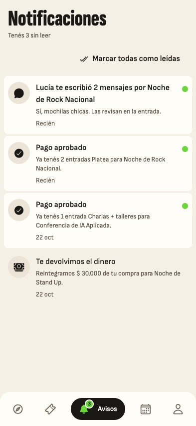
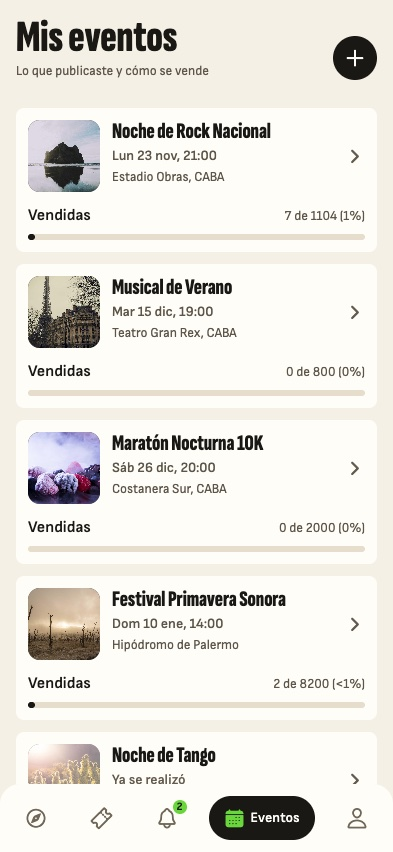
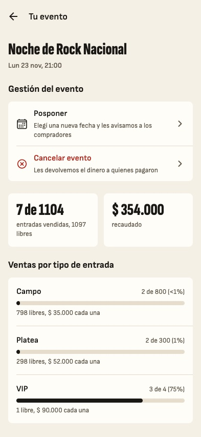
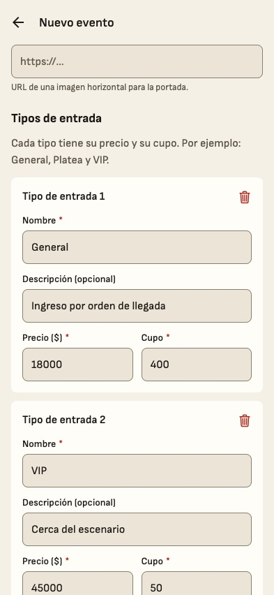
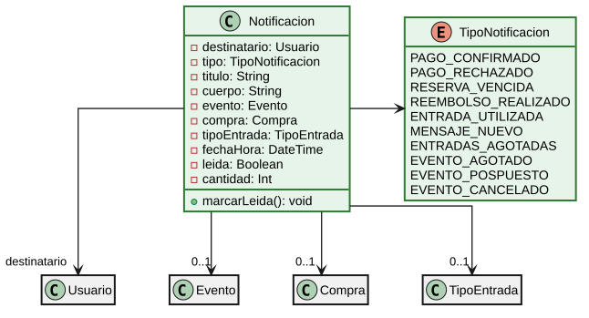

# AI Ticket It

Plataforma para publicar eventos y vender entradas. Los organizadores crean eventos con distintos tipos de entrada y siguen sus ventas; los compradores buscan, compran, chatean con el organizador y reseñan lo que vieron.

Trabajo Práctico Individual de Desarrollo con IA. Diseño de Sistemas de Información, UTN FRBA, 2C 2026.

<table>
  <tr>
    <td align="center"><br /><sub>Explorar</sub></td>
    <td align="center"><br /><sub>Evento</sub></td>
    <td align="center"><br /><sub>Comprar</sub></td>
    <td align="center"><br /><sub>Pagar</sub></td>
    <td align="center"><br /><sub>Mis entradas</sub></td>
  </tr>
  <tr>
    <td align="center"><br /><sub>Chat</sub></td>
    <td align="center"><br /><sub>Avisos</sub></td>
    <td align="center"><br /><sub>Mis eventos (organizador)</sub></td>
    <td align="center"><br /><sub>Ventas (organizador)</sub></td>
    <td align="center"><br /><sub>Nuevo evento (organizador)</sub></td>
  </tr>
</table>

## Estructura

```
ai-ticket-it/
├── backend/
│   ├── src/
│   │   ├── app.js            # arma Express e inyecta dependencias
│   │   ├── routes/           # endpoints + documentación OpenAPI
│   │   ├── controllers/      # HTTP → service → DTO
│   │   ├── services/         # casos de uso
│   │   ├── domain/           # entidades y reglas (estados/ con el patrón State)
│   │   ├── repositories/     # persistencia en memoria
│   │   ├── auth/             # JWT, refresh tokens, bcrypt
│   │   ├── schemas/  dtos/  errors/  middlewares/  infra/  data/  utils/
│   └── test/                 # unit/ (dominio, servicios) e integracion/ (endpoints con Supertest)
├── mobile/
│   ├── src/
│   │   ├── app/              # pantallas (Expo Router: cada archivo es una ruta)
│   │   ├── components/       # ui/ = componentes base del sistema de diseño
│   │   ├── hooks/            # TanStack Query por recurso
│   │   ├── api/  context/  utils/
│   │   └── theme.js          # tokens de diseño (claro y oscuro)
│   ├── test/                 # Jest + React Native Testing Library + MSW
│   └── cypress/              # E2E sobre Expo web
└── docs/
    ├── capturas/             # imágenes de este README
    ├── diagramas/            # fuentes PlantUML y sus SVG
    ├── decisiones-de-diseno.md   # por qué está hecho así
    └── ux.md                 # persona, POV y heurísticas
```

## Empezar en 5 minutos

Requisitos: Node 22.9 o superior y la app **Expo Go** en el celular, conectado al mismo Wi-Fi que la computadora.

```bash
cd backend && npm install && npm run dev
```

```bash
cd mobile && npm install && npx expo start
```

Escaneá el QR con la cámara (iOS) o con Expo Go (Android) e iniciá sesión con un usuario de prueba. La app encuentra sola la IP de la computadora; para usar otra URL, copiá `mobile/.env.example` a `mobile/.env.local`.

| Usuario                                            | Para probar                                                       |
| -------------------------------------------------- | ----------------------------------------------------------------- |
| `sofia@aiticketit.com`, `valentina@aiticketit.com` | Comprar, chatear, cancelar                                        |
| `lucia@aiticketit.com`, `martin@aiticketit.com`    | Gestionar eventos, validar entradas, responder chats              |
| `tomas@aiticketit.com`                             | Las dos cosas, y reseñar (tiene una entrada utilizada sin reseña) |

Contraseña de todos: `aiticketit123`. Para probar un pago rechazado, usá la tarjeta `4000 0000 0000 0002`.

> La persistencia es **en memoria**, como pide el enunciado: al reiniciar el backend vuelven los datos de ejemplo y se cierran las sesiones.

### API

La API está documentada con **Swagger** en http://localhost:3000/api/docs: hacé `POST /api/auth/login`, copiá el `accessToken` y pegalo en **Authorize**. `POST /api/dev/reset` restaura los datos de ejemplo.

En producción (`NODE_ENV=production`, o sin `NODE_ENV`) la API exige `JWT_SECRET` y `CORS_ORIGINS`, no expone Swagger ni `/api/dev` y no carga los usuarios de ejemplo. Ver `backend/.env.example`.

## Casos de uso

| CU   | Descripción                                                              | API | App |
| ---- | ------------------------------------------------------------------------ | :-: | :-: |
| CU1  | Ver mis compras con su estado y los días que faltan (si está confirmada) | ✅  | ✅  |
| CU2  | Organizador: compras de un evento y entradas disponibles por tipo        | ✅  | ✅  |
| CU3  | Buscar eventos por texto o explorarlos por categoría                     | ✅  | ✅  |
| CU4  | Crear un evento con distintos tipos de entrada (precio y cupo)           | ✅  | ✅  |
| CU5  | Comprador: chat dentro de la compra                                      | ✅  | ✅  |
| CU6  | Organizador: responder el chat de la compra                              | ✅  | ✅  |
| CU7  | Cancelar una compra y obtener el reembolso                               | ✅  | ✅  |
| CU8  | Solo se cancela si no está _utilizada_ y el evento no se realizó         | ✅  | ✅  |
| CU9  | Con la entrada utilizada, puntuar el evento y comentar                   | ✅  | ✅  |
| CU10 | Ver las reseñas de eventos anteriores de cada organizador                | ✅  | ✅  |
| CU11 | Ordenar por precio, fecha y puntaje del organizador                      | ✅  | ✅  |
| CU12 | Comprar eligiendo tipo de entrada y cantidad, sin superar el cupo        | ✅  | ✅  |
| —    | Favoritos                                                                | ✅  | ✅  |
| —    | Notificaciones in-app                                                    | ✅  | ✅  |
| —    | Posponer o cancelar un evento                                            | ✅  | ✅  |
| —    | Registro, inicio de sesión (JWT) y edición del perfil                    | ✅  | ✅  |
| —    | Tarjetas guardadas y pago con la pasarela simulada                       | ✅  | ✅  |

## Arquitectura y dominio

Las justificaciones de cada decisión (capas, patrones, estados de la compra, notificaciones, sincronismo y autenticación) están en [`docs/decisiones-de-diseno.md`](docs/decisiones-de-diseno.md).

<p align="center">
  
</p>

<p align="center">
  
</p>

<p align="center">
  
</p>

## Tests

Tests unitarios y de integración con **Jest** en los dos módulos (Supertest en el backend; React Native Testing Library y MSW en la app), E2E con **Cypress sobre Expo web**, ESLint y Prettier. GitHub Actions corre todo en cada PR.

Para correr los E2E hacen falta tres terminales:

```bash
cd backend && AUTH_INTENTOS_MAXIMOS=1000 npm run dev
cd mobile && npx expo start --web --port 8081
cd mobile && npm run e2e
```

Lo nativo (sesión en SecureStore, diálogos, hoja de pago, lector de pantalla) no lo cubre Cypress: se prueba a mano en Expo Go, con la lista de [`mobile/CLAUDE.md`](mobile/CLAUDE.md).

## Comandos

| Qué                        | Dónde                  | Comando                                             |
| -------------------------- | ---------------------- | --------------------------------------------------- |
| API con recarga al guardar | `backend/`             | `npm run dev`                                       |
| Tests y cobertura          | `backend/`             | `npm test` / `npm run coverage`                     |
| Tests por tipo             | `backend/` y `mobile/` | `npm run test:unit` / `npm run test:integration`    |
| Tests de la app            | `mobile/`              | `npm test`                                          |
| E2E (Cypress)              | `mobile/`              | `npm run e2e` (ver [Tests](#tests))                 |
| Lint y formato             | `backend/` y `mobile/` | `npm run lint` / `npm run format`                   |
| App                        | `mobile/`              | `npx expo start` (`w` para abrirla en el navegador) |
