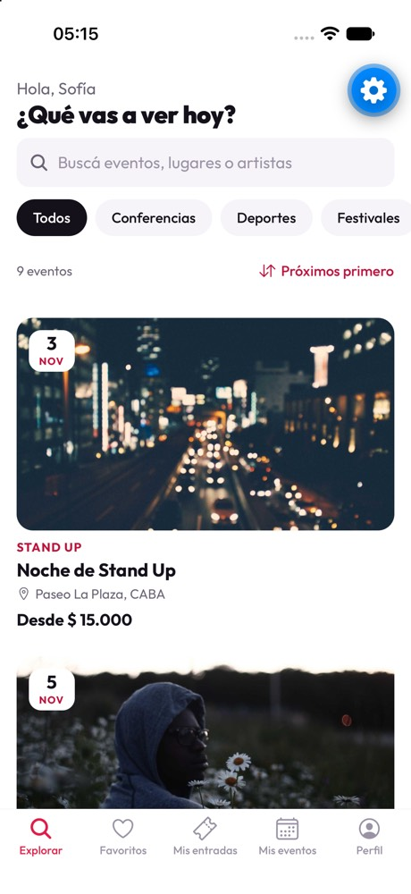
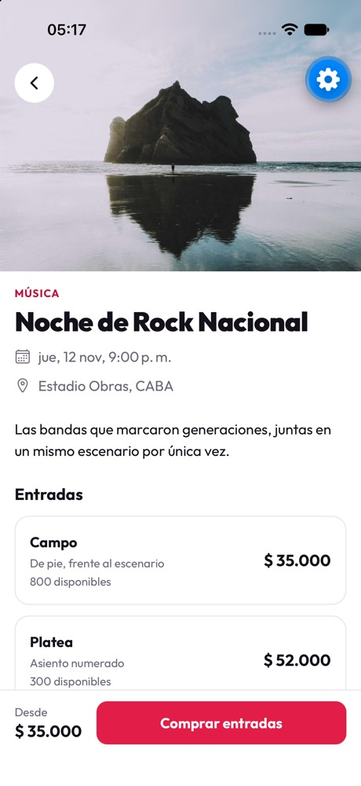
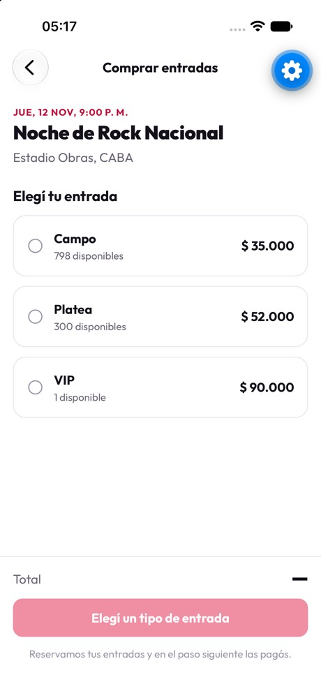
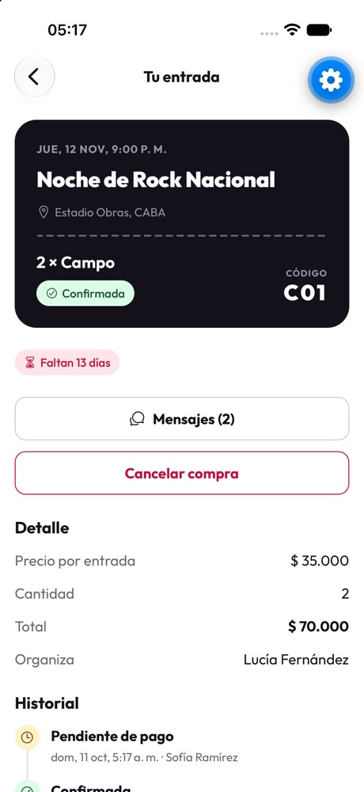
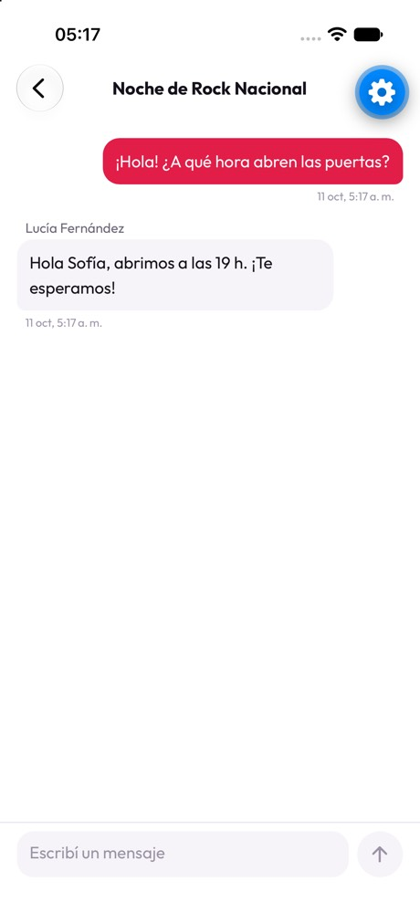
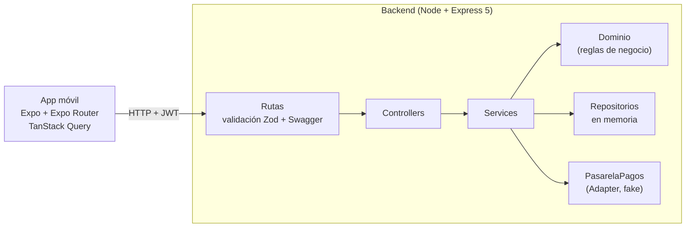
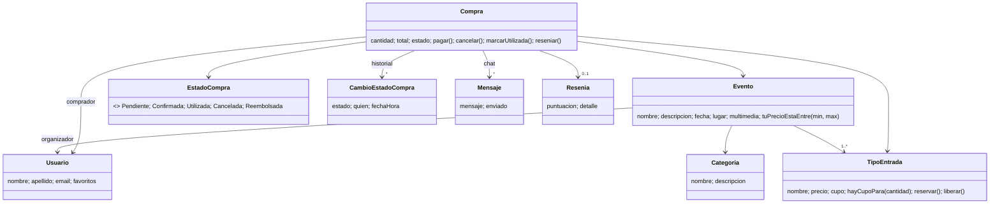

# AI Ticket It

Plataforma para publicar eventos y vender entradas: los organizadores crean eventos con distintos tipos de entrada y siguen sus ventas; los compradores buscan, compran, chatean con el organizador y reseñan lo que vieron.

Trabajo Práctico Individual de Desarrollo con IA — Diseño de Sistemas de Información, UTN FRBA, 2C 2026.

<p>
  
  
  
  
  
</p>

## Empezar en 5 minutos

Requisitos: Node 22.9 o superior y la app **Expo Go** en el celular, conectado al mismo Wi-Fi que la computadora.

```bash
cd backend && npm install && npm run dev
```

```bash
cd mobile && npm install && npx expo start
```

Escaneá el QR con la cámara (iOS) o con Expo Go (Android) e iniciá sesión con un usuario de prueba. La app encuentra sola la IP de la computadora; para usar otra URL, copiá `mobile/.env.example` a `mobile/.env.local`.

| Usuario                                            | Para probar                                          |
| -------------------------------------------------- | ---------------------------------------------------- |
| `sofia@aiticketit.com`, `valentina@aiticketit.com` | Comprar, chatear, cancelar, reseñar                  |
| `lucia@aiticketit.com`, `martin@aiticketit.com`    | Gestionar eventos, validar entradas, responder chats |
| `tomas@aiticketit.com`                             | Las dos cosas                                        |

Contraseña de todos: `aiticketit123`.

La API está documentada con **Swagger** en http://localhost:3000/api/docs: hacé `POST /api/auth/login`, copiá el `accessToken` y pegalo en **Authorize**. `POST /api/dev/reset` restaura los datos de ejemplo.

> La persistencia es **en memoria** (lo pide el enunciado): todos los dispositivos comparten los datos a través del backend, pero al reiniciarlo se vuelven a cargar los datos de ejemplo y se cierran las sesiones.

> En producción (`NODE_ENV=production`, o sin `NODE_ENV`) la API exige `JWT_SECRET` y `CORS_ORIGINS`, no expone Swagger ni `/api/dev` y arranca solo con las categorías: los usuarios de ejemplo no existen. Ver `backend/.env.example`.

### Inicio de sesión con Google (opcional)

1. En [Google Cloud Console](https://console.cloud.google.com/apis/credentials) creá un ID de cliente OAuth de tipo **Aplicación web** con origen y URI de redirección `http://localhost:8081`.
2. Poné ese ID en `backend/.env` como `GOOGLE_CLIENT_IDS` y en `mobile/.env.local` como `EXPO_PUBLIC_GOOGLE_WEB_CLIENT_ID`, y reiniciá los dos.
3. El botón "Continuar con Google" aparece en el login web. En el celular necesita una development build con un ID de cliente de iOS (`EXPO_PUBLIC_GOOGLE_IOS_CLIENT_ID`): Expo Go no puede volver del login de Google.

## Casos de uso

| CU   | Descripción                                                              | API | App |
| ---- | ------------------------------------------------------------------------ | :-: | :-: |
| CU1  | Ver mis compras con su estado y los días que faltan (si está confirmada) | ✅  | ✅  |
| CU2  | Organizador: compras de un evento y entradas disponibles por tipo        | ✅  | ✅  |
| CU3  | Buscar eventos por texto o explorarlos por categoría                     | ✅  | ✅  |
| CU4  | Crear un evento con distintos tipos de entrada (precio y cupo)           | ✅  | ✅  |
| CU5  | Comprador: chat dentro de la compra                                      | ✅  | ✅  |
| CU6  | Organizador: responder el chat de la compra                              | ✅  | ✅  |
| CU7  | Cancelar una compra y obtener el reembolso                               | ✅  | ✅  |
| CU8  | Solo se cancela si no está _utilizada_ y el evento no se realizó         | ✅  | ✅  |
| CU9  | Con la entrada utilizada, puntuar el evento y comentar                   | ✅  | ✅  |
| CU10 | Ver las reseñas de eventos anteriores de cada organizador                | ✅  | ✅  |
| CU11 | Ordenar por precio, fecha y puntaje del organizador                      | ✅  | ✅  |
| CU12 | Comprar eligiendo tipo de entrada y cantidad, sin superar el cupo        | ✅  | ✅  |
| —    | Favoritos                                                                | ✅  | ✅  |
| —    | Registro e inicio de sesión (JWT)                                        | ✅  | ✅  |

## Arquitectura



- **Capas**: rutas → controllers → services → dominio → repositorios. Los controllers no tienen reglas; el dominio no sabe de HTTP. Las dependencias se arman a mano en `backend/src/app.js`, y los tests las reemplazan (reloj fijo, repositorios vacíos, pasarela que falla).
- **Patrones**:
  - **State**: cada estado de la compra (`domain/estados/`) define qué transiciones permite.
  - **Strategy**: el orden de la búsqueda por fecha, precio o puntaje (`domain/OrdenEventos.js`).
  - **Adapter**: la pasarela de pagos (`infra/PasarelaPagosFake.js`), reemplazable por un proveedor real.
- **Autenticación**: contraseñas con bcrypt, access token JWT de 15 minutos y refresh token opaco de 30 días que rota en cada uso (si se reutiliza, se revoca la sesión). Rate limit en login y registro.
- **Calidad**: 170 tests (Vitest + Supertest), ESLint, Prettier y CI de GitHub Actions para el backend y la app.

### Dominio



Estados de una compra: `PENDIENTE` → `CONFIRMADA` → `UTILIZADA`, o `CANCELADA` (→ `REEMBOLSADA` si estaba paga). Las reglas completas están en [`backend/CLAUDE.md`](backend/CLAUDE.md).

## Estructura

```
ai-ticket-it/
├── backend/
│   ├── src/
│   │   ├── app.js            # arma Express e inyecta dependencias
│   │   ├── routes/           # endpoints + documentación OpenAPI
│   │   ├── controllers/      # HTTP → service → DTO
│   │   ├── services/         # casos de uso
│   │   ├── domain/           # entidades y reglas (estados/ con el patrón State)
│   │   ├── repositories/     # persistencia en memoria
│   │   ├── auth/             # JWT, refresh tokens, bcrypt
│   │   ├── schemas/  dtos/  errors/  middlewares/  infra/  data/
│   └── test/                 # unit/ (dominio, servicios) y api/ (endpoints)
├── mobile/
│   └── src/
│       ├── app/              # pantallas (Expo Router: cada archivo es una ruta)
│       ├── components/       # ui/ = componentes base del sistema de diseño
│       ├── hooks/            # TanStack Query por recurso
│       ├── api/  context/  utils/
│       └── theme.js          # tokens de diseño (claro y oscuro)
└── docs/capturas/
```

## Comandos

| Qué                        | Dónde                  | Comando                                             |
| -------------------------- | ---------------------- | --------------------------------------------------- |
| API con recarga al guardar | `backend/`             | `npm run dev`                                       |
| Tests y cobertura          | `backend/`             | `npm test` / `npm run coverage`                     |
| Lint y formato             | `backend/` y `mobile/` | `npm run lint` / `npm run format`                   |
| App                        | `mobile/`              | `npx expo start` (`w` para abrirla en el navegador) |

## Pendiente

- Inicio de sesión con Google (SSO).
- Escanear el QR de la entrada para validarla.
- Chat en tiempo real (SSE o WebSocket) en lugar de consultar cada 3 segundos.
- Notificaciones push, subir imágenes, base de datos real y deploy.
