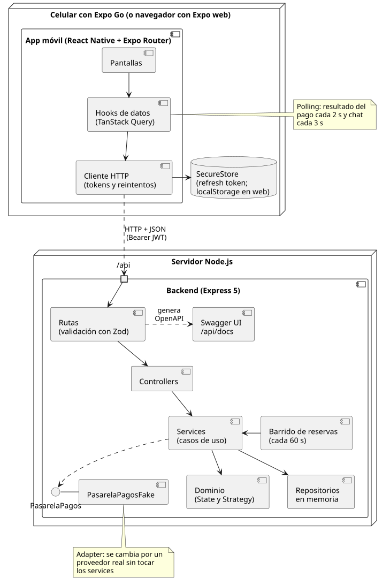
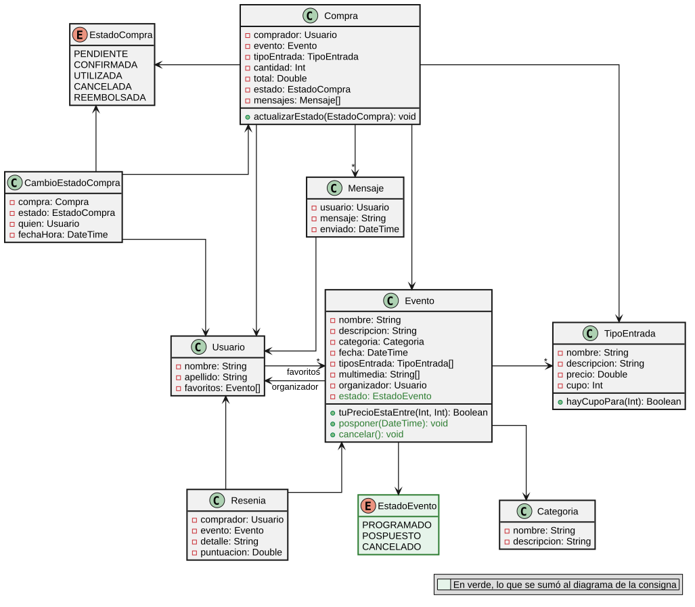
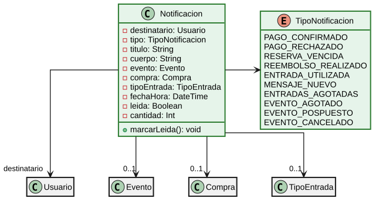

# Decisiones de diseño

Por qué AI Ticket It está hecho como está. El [README](../README.md) cuenta qué es y cómo se levanta; acá están las justificaciones.

## Arquitectura

  

Diagrama de componentes UML hecho con **PlantUML**, la misma herramienta del diagrama de clases del enunciado. La fuente es [`diagramas/arquitectura.puml`](diagramas/arquitectura.puml).

- **Capas**: rutas → controllers → services → dominio → repositorios. Los controllers no tienen reglas y el dominio no sabe de HTTP. Las dependencias se arman a mano en `backend/src/app.js`, y los tests las reemplazan (reloj fijo, repositorios vacíos, pasarela que falla).
- **Patrones**: **State** para los estados de la compra (`domain/estados/`), **Strategy** para ordenar la búsqueda (`domain/OrdenEventos.js`) y **Adapter** para la pasarela de pagos (`infra/PasarelaPagosFake.js`), que se puede cambiar por un proveedor real.
- **Pagos**: el cobro es asincrónico, como con una pasarela real. `POST /compras/:id/pago` responde 202 y la app consulta el resultado con polling. El header `Idempotency-Key` evita el doble cobro si se pierde una respuesta.
- **Reservas**: el cupo se toma al reservar y la reserva dura 15 minutos. Si no se paga, un barrido que corre cada minuto la cancela y libera las entradas. Con un pago en curso no vence. El mismo barrido retoma los reembolsos que quedaron pendientes al cancelar un evento.
- **Validación y documentación**: **Zod** valida cada request y genera la documentación OpenAPI que sirve Swagger, así que la documentación no se puede desincronizar del código.
- **Persistencia en memoria**, como pide el enunciado: un repositorio genérico (`repositories/RepositorioEnMemoria.js`, sobre un `Map`) que los services reciben inyectado, así que se podría cambiar por una base de datos sin tocarlos.

## Modelo de dominio

  

Es el diagrama de clases del enunciado, pasado a PlantUML ([`clases.puml`](diagramas/clases.puml)), y los nombres del código son los mismos. En verde, lo que se sumó. Las notificaciones van en un diagrama aparte para que este se lea sin flechas cruzadas. El original de la cátedra se conserva en [`clases-consigna.png`](diagramas/clases-consigna.png). Lo que agrega la implementación:

- **Usuario** es una sola clase: _comprador_ y _organizador_ son roles, no subclases, porque la misma persona puede comprar entradas y publicar eventos.
- **EstadoCompra** usa el patrón State: además del enum con los nombres, cada estado es una subclase de `Estado` (`domain/estados/`) que decide qué acciones permite. Así, "¿se puede cancelar?" lo responde el estado y no una cadena de `if` repartida por los services. `actualizarEstado` deja el cambio en el historial de `CambioEstadoCompra`.
- **Compra** suma el vencimiento de la reserva, la operación de pago y su reseña.
- **TipoEntrada** reserva y libera cupo, y **Resenia** se puntúa de 1 a 5.
- **Tarjeta** guarda las tarjetas del comprador para pagar.
- **EstadoEvento** (`PROGRAMADO`, `POSPUESTO`, `CANCELADO`): el organizador puede `posponer` el evento, que mantiene las entradas, o cancelarlo (`cancelar`), que cancela todas sus compras vigentes y reembolsa las pagadas.

### Estados de una compra

`PENDIENTE` → `CONFIRMADA` → `UTILIZADA`, o `CANCELADA` (→ `REEMBOLSADA` si estaba paga; una entrada gratis queda `CANCELADA`, porque no hay nada que devolver).

Dos transiciones parecen raras y son a propósito:

- **Posponer devuelve una `UTILIZADA` a `CONFIRMADA`.** El evento no se hizo, así que la entrada vale para la nueva fecha, se vuelve a validar en la puerta y, si la persona no puede ir, la cancela con reembolso.
- **Cancelar el evento cancela también las `UTILIZADA`.** Si el evento no se realiza, nadie lo usó: se reembolsa a todos los que pagaron.

Las reglas completas están en [`backend/CLAUDE.md`](../backend/CLAUDE.md).

### Notificaciones

  

**Notificacion** es el aviso in-app de cada persona, y `TipoNotificacion` dice de qué es ([`notificaciones.puml`](diagramas/notificaciones.puml)). Las clases en gris son las del diagrama anterior. Las crean los services después de persistir, así un aviso nunca anuncia algo que no se guardó.

Para no saturar a nadie:

- Los mensajes del chat sin leer se juntan en una sola notificación por compra y destinatario, con el conteo en `cantidad`. Abrir el chat la marca leída.
- Al organizador no se le avisa cada compra. Además de los mensajes del chat, recibe el aviso de agotado (una vez por tipo y por evento) y el de devolución cuando un comprador cancela una compra que ya tenía las entradas, con cuántas eran y cuánto se le reintegró.

## Sincronismo

La regla de la cátedra es empezar por polling y subir de nivel solo si la latencia o la carga lo justifican.

| Parte de la app                        | Técnica                                                                                                                           | Por qué                                                                                                                                                                               |
| -------------------------------------- | --------------------------------------------------------------------------------------------------------------------------------- | ------------------------------------------------------------------------------------------------------------------------------------------------------------------------------------- |
| Resultado de un pago                   | Polling cada 2 s, con máximo de intentos                                                                                          | Es una espera corta y con final. Frena al resolverse, y si se agotan los intentos la app lo dice en lugar de dejar a la persona esperando.                                            |
| Chat (CU5 y CU6)                       | Polling cada 3 s, solo con la pantalla abierta                                                                                    | La PPT sugiere WebSockets para un chat, pero acá son mensajes esporádicos entre dos personas: un atraso de 3 s no molesta y no hay carga que justifique mantener conexiones abiertas. |
| Notificaciones                         | Polling cada 15 s, con la app abierta                                                                                             | Son avisos esporádicos y no urgentes. Los mensajes del chat sin leer se juntan en una sola notificación, y abrir el chat la marca leída.                                              |
| Mis entradas y compras del organizador | Refresco al volver a la app, al deslizar hacia abajo y después de cada acción; en Mis entradas, polling si hay un pago en proceso | Los estados cambian poco. Solo vale la pena consultar seguido cuando se está esperando algo concreto.                                                                                 |
| Reserva sin pagar, en la compra        | Consulta a la hora límite y cada 30 s con el plazo cumplido                                                                       | La app pregunta cuando algo cambia, sin calcular el plazo por su cuenta. Con el reloj del celular corrido, nunca consulta más seguido que cada 5 s ni espera más de 1 minuto.         |
| Cancelación de un evento               | Se completa en segundo plano                                                                                                      | Al cancelar se reembolsa lo que se puede en el momento. Si la pasarela no responde, las compras quedan canceladas y el barrido (cada 60 s) las reembolsa cuando vuelve.               |
| Entradas disponibles al comprar        | Datos siempre frescos al abrir, y refresco ante `SIN_CUPO`                                                                        | El cupo se valida en el backend al reservar, así que un dato un poco viejo no permite sobrevender: como mucho, el error se ve un paso después.                                        |
| Server-Sent Events                     | No se usa                                                                                                                         | `EventSource` no permite headers propios (la app usa un bearer token) y React Native no lo trae incorporado.                                                                          |
| WebSockets                             | No se usa                                                                                                                         | Queda como mejora si el chat creciera: suma una conexión por persona y reconexión manual, sin una necesidad que lo pague hoy.                                                         |

### Preguntas de la Semana 10

**¿Todos los endpoints brindan una respuesta "instantánea"?**
No. La mayoría lee o escribe en memoria y responde enseguida, pero cobrar depende de un servicio externo que puede tardar. Por eso `POST /compras/:id/pago` no espera el resultado.

**¿Qué pasa si el backend procesa la solicitud en un momento posterior?**
Hay que separar "lo recibí" de "lo terminé". El pago responde 202 con un `operacionId` y la app consulta `GET /compras/:id/pago/:operacionId` hasta que queda APROBADA o RECHAZADA. La compra sigue PENDIENTE mientras tanto, y el estado "en proceso" vive en `OperacionPago`.

**¿Qué pasa si el backend hace un procesamiento pesado y responde en el momento?**
La conexión queda ocupada todo ese tiempo y, si se corta, el cliente no sabe cómo terminó. Ese es el caso peligroso: el cobro pudo salir y la respuesta perderse. Por eso existen el 202 y la `Idempotency-Key`: reintentar con la misma clave devuelve lo mismo, sin cobrar de nuevo.

**¿Qué pasa si hay mucha latencia en cada llamada?**
La app tiene que seguir explicando qué pasa:

- Skeletons y spinners mientras carga.
- Caché entre pantallas y datos del listado mientras llega el detalle.
- Timeout de 15 s en cada request, para no quedarse en un skeleton para siempre.
- Reintentos solo en lecturas, con backoff y azar, y Reintentar solo si puede servir.
- Debounce en la búsqueda y `signal` para cancelar lo que ya nadie espera.

**¿El usuario debería poder seguir usando el sistema o la pantalla es cautiva?**
Depende de qué se pierde si se va. El pago es cautivo mientras se inicia y se espera, porque salir sin saber el resultado invita a pagar de nuevo: no se cierra con la cruz, tocando afuera ni con "atrás". Pero tiene un máximo de intentos: al agotarse, la hoja se cierra y avisa que el pago sigue en proceso. Todo lo demás (buscar, favoritos, chat) no bloquea.

## Autenticación

Contraseñas con **bcrypt**, access token **JWT de 15 minutos** y refresh token opaco de **30 días** que rota en cada uso. Rate limit en login y registro.

**¿Por qué el access token dura minutos y el refresh token días? ¿Qué pasa si roban cada uno?**
El access token viaja en cada request y se verifica sin consultar nada, así que no se puede revocar: se limita el daño con una vida corta. Si lo roban, sirve como máximo 15 minutos.

El refresh token viaja solo al renovar y se puede revocar porque está guardado del lado del servidor, por eso puede durar 30 días y evitar que la persona inicie sesión a cada rato. Para protegerlo:

- En el celular va en SecureStore.
- En el backend se guarda solo su hash SHA-256.
- Rota en cada uso: si alguien lo reutiliza, se detecta y se revoca toda la sesión.

**Al cerrar sesión, ¿el JWT deja de ser válido?**
No: un JWT es válido hasta que vence, porque el backend solo verifica la firma y la fecha. En esta app sigue sirviendo hasta 15 minutos. Al cerrar sesión, la app lo borra de la memoria y el backend revoca el refresh token, así que no se puede renovar.

Para invalidarlo en el momento haría falta consultar algo en cada request, por ejemplo una lista de tokens revocados (por `jti`) o una versión de sesión en el usuario. Eso resigna parte de la ventaja de no guardar estado. No se hizo: con 15 minutos de vida, la exposición es acotada.
